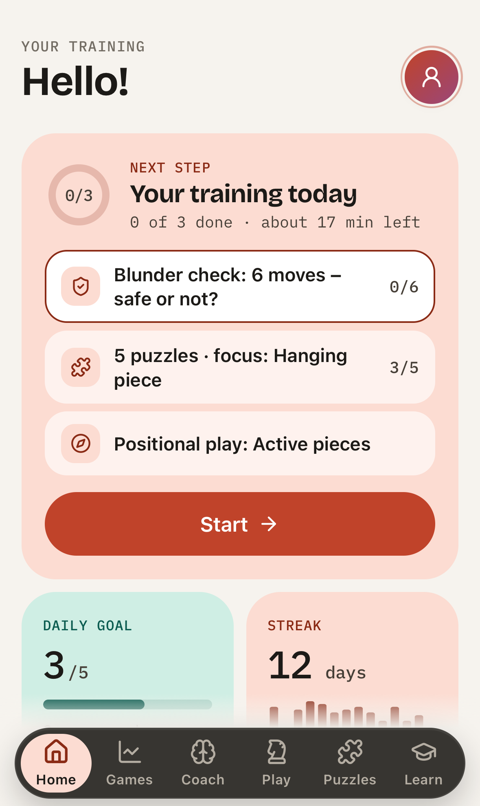
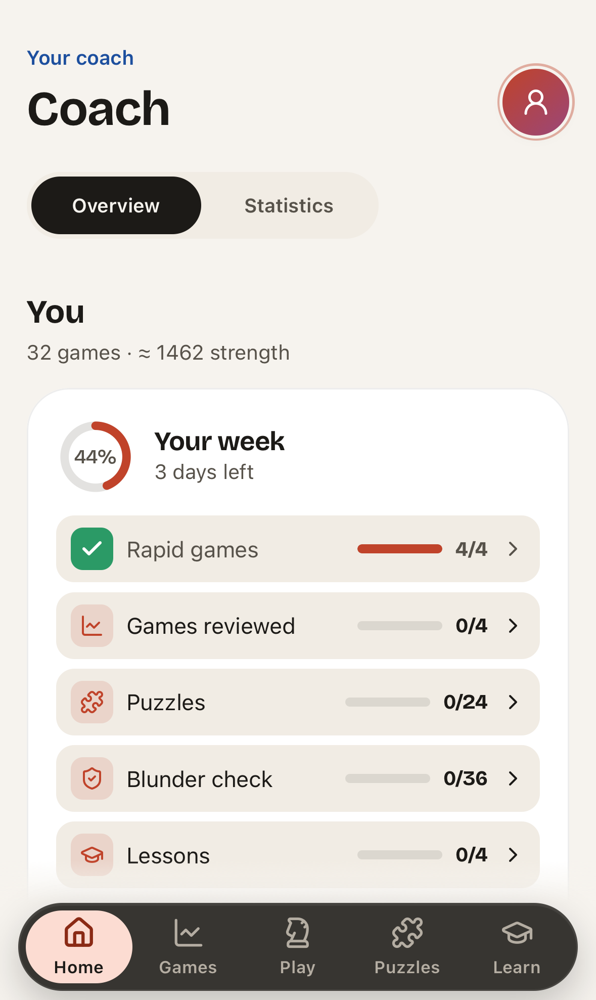
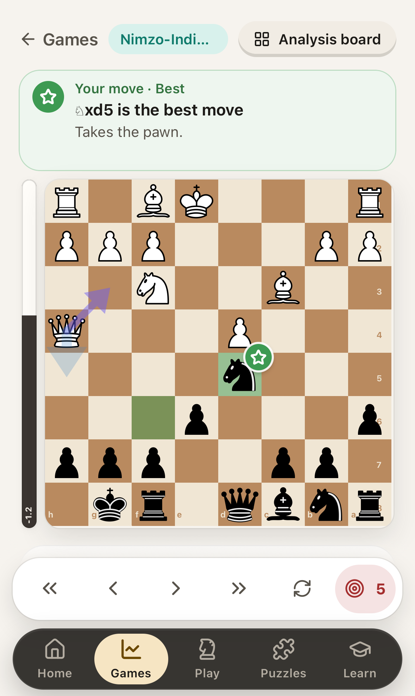
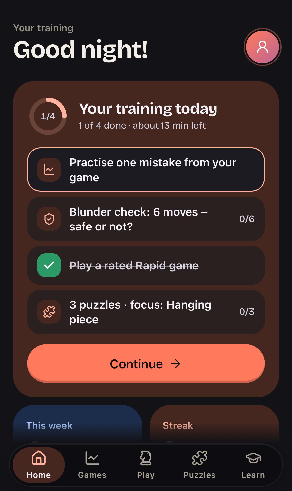
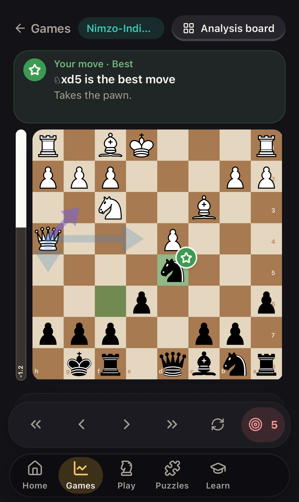
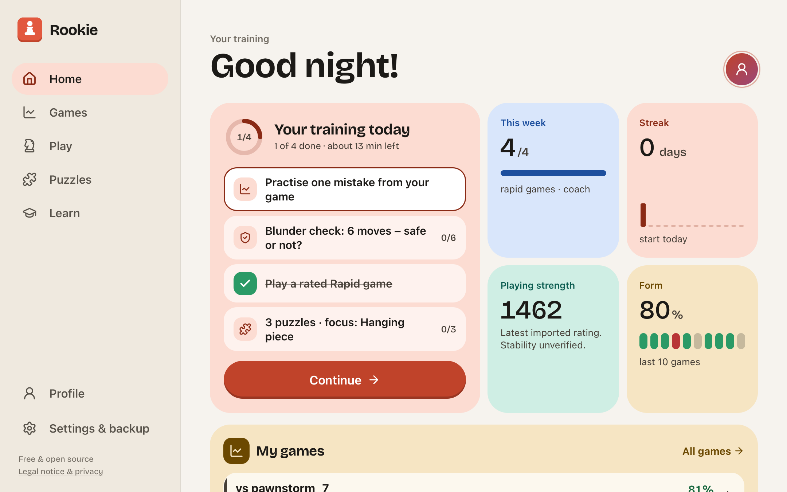

# Rookie – a free chess trainer

A chess trainer for beginners as a Progressive Web App for iPhone, iPad and Mac – completely free, offline-capable, no App Store, no account, no tracking. English and German.

**Live:** https://rookie.maximilianauer.at · **Version:** 0.13.0

| Home                                                                                                                                                        | Coach                                                                                                                                                                                        | Play                                                                                                   | Game review                                                                                                                                   | Blunder check                                                                                            |
| ----------------------------------------------------------------------------------------------------------------------------------------------------------- | -------------------------------------------------------------------------------------------------------------------------------------------------------------------------------------------- | ------------------------------------------------------------------------------------------------------ | --------------------------------------------------------------------------------------------------------------------------------------------- | -------------------------------------------------------------------------------------------------------- |
|  |  |  |  |  |
|                                                                              |                                                                                                       |                          |                                                      |                 |

**Desktop** (Mac, iPad landscape)

| Light                                                                                                                                                                                                          | Dark                                                                                                         |
| -------------------------------------------------------------------------------------------------------------------------------------------------------------------------------------------------------------- | ------------------------------------------------------------------------------------------------------------ |
|                     |            |
|  |  |

Screenshots use generated sample data (`scripts/screenshots/`), not real games.

## What's new in 0.13.0

- **The coach is home:** the first tab is the Coach again. At the top sits your road to 1600 – your playing strength, how far it is, and the stages 800 to 1600 as a staircase – with one sentence from the coach about what matters this week. Below: today’s plan.
- **How you play:** the former coach page (your week, penta, focus, progress, statistics) is now “How you play”, one tap from home.
- **Calmer menu:** a light paper tab bar; the active area is a pastel tile with the same pressable edge as buttons and the app icon. Five tabs fill the bar evenly.

## What's new in 0.12.0

- **Clearer structure:** five tabs instead of six – the Coach now sits under Home (the week and playing-strength tiles lead there). Every number has one home: Home shows today, the Coach the analysis, the Profile your achievements.
- **Less text, calmer numbers:** shorter copy everywhere, explanations behind “What does this mean?”, numbers set in Bricolage instead of monospace.
- **Pages:** search and folded months in the game list; one entry to replay mistakes; mistake types first in the move table; opponents first on Play; one daily goal on Puzzles; a mini board for every opening course; endgames on their own page; settings options in one row.

## What's new in 0.11.0

- **More human bots:** bots play real openings from the opening database (stronger bots stay in theory longer), almost always recapture, and their mistakes are plausible – a greedy capture or a weaker candidate move instead of a random move. They also think like people: book moves and recaptures come quickly, close positions take longer.
- **New app icon:** a white pawn on a coral tile with a pressable edge, like the buttons.
- **Pastel polish:** clearer dark mode with real pastel tints, pressable buttons, labels in sentence case instead of capitals, the page header in the colour of its area, a short check-mark moment when a daily task is done, shorter text on the account card and a maximum width for pages without a board on large screens.

## What's new in 0.10.0

Measured, not guessed ([research](docs/research-2026-11-13.md#nachtrag-bedenkzeit-messschwankung-und-chesscom-21-november-2026), [plan](docs/plan-2026-11-21.md)).

- **Clock:** Lichess games now come with clock times (older imports get them on the next sync). A new Coach card per time control shows how much of your time you spend by move 10, games lost on time and blunders in time trouble – with one next step. Time trouble causes only 1–7 % of blunders, but opening speed separates levels: with it, blitz is estimated within ±234 Elo (penta alone ±288) and **bullet becomes measurable** (±267, before worse than guessing).
- **Does it work?** The progress chart judges your rating over the last 15 games against the measured noise (±47) and shows how many games a week you played. The playing level varies by up to ±650 between two 15-game windows by chance, so it cannot answer that.
- **Chess.com ↔ Lichess:** an own sample of 85 rapid and 87 blitz Chess.com players replaces the flat +150: Chess.com rapid ≈ 1.209 × Lichess − 608. Chess.com-only players get the progress chart in Chess.com rapid and penta figures on their scale.
- **Retrieval tasks:** twelve lessons now end with a new, unseen position where you apply the idea yourself – all checked with Stockfish.

## What's new in 0.9.0

- **Skill penta for each time control:** switch between Rapid (default), Classical, Blitz and Bullet; bot games never count. Blitz has its own Lichess calibration – checked on 59 players outside it: within ±300 Elo (guessing: ±480); its tactics corner was worse than guessing and stays hidden. **Bullet shows no penta:** move quality predicted bullet ratings worse than guessing (57 players) – the clock decides most ([research](docs/research-2026-11-13.md#nachtrag-skill-penta-für-blitz-und-bullet-spielniveau-statt-trainingsindex-20-november-2026)).
- **Playing level instead of training index:** your progress chart shows the penta's overall level from your last 15 analysed Rapid games on the same Elo axis as your Lichess rating. The old 0–100 index moved only ~11 points from 900 to 1700 and could not be read on its own.
- **Provisional ratings are left out:** the first jumpy games of a new Lichess account no longer count for the rating line or its change.

## What's new in 0.8.0

Rookie now prescribes a weekly dose instead of offering options – measured on 883 new Lichess players around 900 Rapid ([research](docs/research-2026-11-13.md#nachtrag-wie-viel-spielen-wie-viele-puzzles-aufstieg-neuer-lichess-spieler-20-november-2026), [review](docs/coach-review-2026-11-20.md), [plan](docs/coach-plan-2026-11-20.md)).

- **Your week** in the Coach: games (10+5), reviews, puzzles, blunder checks and lessons for your time budget – 4 games a week from 30 minutes a day, up to 8. Players with fewer than 2 games a week hardly improved in a year; with 4–8 they gained +137 (median).
- **The coach judges your progress:** too few games → play; games not reviewed → review first; rating flat for 6 weeks with many blunders → 15+10 and the blunder check; otherwise tactics.
- **Road to 1600:** your next milestone and the blunder rate that is typical there – plus an honest note on how long it usually takes.
- Puzzles every day, also on game days. "Continue learning" now matches the daily plan, with tactics lessons below 1400. One blunder number everywhere. At most two new mistake cards per game, so heavy players can keep up.

## What's new in 0.7.9

- The Coach shows a training index and your actual Lichess Rapid rating on a shared timeline for 7 days, 30 days, 1 year or all time.
- View blunders, accuracy, game results and analysis coverage. Open the calculation details to see the data and formula behind each line. [How the index is calculated](docs/coach-verlauf.md).

## What's new in 0.7.8

- In Move and Reply, choose your own move, then play a strong reply for your opponent. A separate six-position check records first answers and shows the score after the last position.
- A Rapid import links directly to one important mistake, with the next review date and a way back to the daily plan.
- The basics lead to a first game against the easiest bot. The automatic coach uses recent unaided Move and Reply results to decide when to ask rather than warn.

## What's new in 0.7.7

- Bot games use the available board width on phones in portrait. The game controls sit below the player row so every square stays tappable on short screens.
- Coach feedback and highlights update without reapplying an identical chess position.

## What's new in 0.7.6

- The daily plan starts with missing rules, then guides you to rated Rapid and a short review of your game. The 5-minute setting keeps the next Rapid session visible.
- The road to 1600 shows your latest imported rated Lichess Rapid rating. Game trends use that same pool. Puzzle scores and bot results stay separate.
- Practise one important mistake from a game and save its result for spaced review.

## What's new in 0.7.5

- Blunder Check, including the check-up, explains each answer immediately. The score trend compares check-ups with the same feedback format.
- Board Scan counts real captures and shows a checking castle with the king's destination. Training shows progress against today's plan.
- The game self-review shows the current move and your marks, then offers to replay the mistakes or return to the original game.
- Mobile bot games keep the board steady during play. Promotion shows four larger piece graphics and a Cancel button.

## Features

Rookie's goal: take beginners to **1600** – with methods that learning research and real game data support ([research](docs/research-2026-11-13.md), [review](docs/learning-review-2026-11-13.md), [plan](docs/learning-plan-2026-11-13.md), [product review](docs/product-review-2026-11-14.md)).

- **Skill penta** – your game as five skills (safety, tactics, opening, positional play, endgame), each as an Elo equivalent calibrated on 1,560 Lichess games from 400 to 3200; 100 = world elite. **Checked on 139 real players outside the calibration:** overall level within ±230 Elo from about 12 games (guessing: ±500); a corner only appears once it beats guessing. Tap a corner: one number, values at other levels and one next step – if your opening or endgame losses are mostly blunders, it sends you to the blunder check instead of more theory
- **What counts at your level** – four stages on the way to 1600 and beyond; the weight of each skill comes from real games (below 1200, safety and tactics explain most of the gap to the next level)
- **Board scan** – see checks, captures and hanging pieces in seconds, for you and your opponent (CCA), on real positions; daily in the plan below 1200
- **Positional play** – five lessons with Stockfish-checked tasks: active pieces and outposts, open files, passed pawns, king safety, pawn structure
- **Blunder check** – “You want to play ♘c4. Is it safe?” Real moments from Lichess games (the move a human actually blundered with, or a Stockfish-verified safe move); say “not safe” and you have to show the refutation on the board. Below 1000, over half of all blunders are pieces or mates lost within two moves – this trains exactly that
- **Your week** – the coach's dose for your level and time budget: games per week (10+5), reviews, puzzles, blunder checks and lessons, with progress, a verdict when your rating stalls and an honest road to 1600. Based on 883 new Lichess players: fewer than 2 games a week hardly helped, 4–8 gained +137 in a year (median), many puzzles went with faster progress
- **Daily plan with a time budget** (30 min by default) – blunder check, your own mistakes due for review, puzzles every day, your week's games spread evenly, then the next lesson for your level (rules → tactics below 1400 → positional play, endgames, openings); shows how many minutes are left
- **You first** – in the game review you can first mark up to three moves you think were mistakes (no engine ratings shown), then Stockfish reveals what you found, missed or got right, and you replay the mistakes; “mistakes spotted” becomes a progress metric
- **Chance!** – in your first guided games the coach points out when your opponent just blundered (beginners leave about half of them unpunished)
- **Your mistakes come back** – every blunder from your games (bot games are analysed automatically in the background) returns as a task after 1, 3, 8 and 22 days until it sticks
- **Puzzles at the right difficulty** – aimed at ~80 % success instead of 50 %, adjusted to your recent results; a hint counts half; the plan's focus is mixed with other themes
- **Coach that steps back** – warns about threats until recent unaided exercises show consistent results, then asks “what is your opponent up to?” (you can still ask for help). The coach comments as the game continues, and you can take back a move during play. Wins with takebacks or hints don't count towards your strength
- **Is your training working?** (Coach → Statistics) – blunders per 30 moves (last 10 games vs the 10 before, with an honest “still within chance”), a safety check-up every two weeks (fixed tasks, two alternating forms) and hit rates in training
- **Game rating** – for each game: accuracy and the level it is typical of, how good the game was for players of your strength (percentile), accuracy per phase, the turning point, chances taken or missed and one lesson to practise. No fake “performance Elo” – measured on 1,440 Lichess games, a single game's accuracy barely predicts rating (R² = 0.14)
- **Fair move ratings** – if two moves were practically equal, yours isn't a mistake; small slips in decided positions don't count; good moves get “just as strong: …” instead of “even stronger was …”
- **Play** against 8 bots with personality (≈ 400–1650) – Stockfish 19 (WebAssembly) in the browser, hints, takebacks, optional clock, and one premove while the bot is thinking. Premoves play automatically if legal after the reply. Tap the premove label, right-click the board, or press Esc to clear it
- **Game review** – every move classified and explained in plain language, the engine's best moves, evaluation graph, PGN import/export; try your own lines directly on the review board and return to the original game; **replay your mistakes** and find the better move
- **What stands out** – only statements backed by enough games and beyond chance (e.g. an opening at least 8 games and clearly below your average), most important first, each with a matching exercise
- **Road to 1600** – the latest imported rated Lichess Rapid result anchors the plan when available. Local practice estimates guide the exercises while you build a real-game history
- **One blunder number** – “blunders per 30 moves” means the same everywhere (moves in still-open positions), plus **converted**: how many clearly won positions you actually won (Lichess players up to 1400: ≈ 69 %)
- **Tactics** – fork, pin, skewer, discovered attack, back-rank mate: explained, then practised with puzzles; **Puzzle Storm**; **play a friend** on one device
- **Chess basics** – 15 interactive lessons from zero
- **Puzzles** – 38,400 puzzles from the free Lichess database, Glicko-2 rating, theme filter, puzzle of the day
- **Endgame trainer** – 10 lessons against perfect tablebase play (two thirds of beginner games reach an endgame)
- **Opening courses** – 14 openings and defences; learned lines go into your repertoire for spaced repetition
- **Linked accounts** – link your Lichess / Chess.com username, new games are imported and analysed automatically
- **Optional account** – passkey sign-in, sync across devices; export and delete at any time
- Light/dark mode, English/German, board themes and piece sets, sounds, backup export/import (restoring merges – nothing is lost), works offline, no tracking – all measurements stay on your device

## Development

Document each change in its GitHub pull request. Describe what changed, why, and how it was verified. Record user-visible changes in the release notes.

```bash
npm install          # also copies Stockfish to static/engine
npm run dev          # http://localhost:5173
npm run build && npm run preview
```

Tests:

```bash
npm run test:unit -- --run   # Vitest
npm run test:e2e             # Playwright: iPhone & Mac Safari (WebKit) + Chromium
npm run check && npm run lint
```

Screenshots and design checks:

```bash
node scripts/screenshots/gen-fixture.mjs        # sample games played by Stockfish (committed)
npm run build && npm run preview -- --port 4173 &
node scripts/screenshots/shoot.mjs out/          # all key pages, 4 sizes, light/dark, overflow check
node scripts/contrast.mjs                        # WCAG contrast of the pastel tokens
```

Data scripts (results are committed):

```bash
# Puzzle packs from the Lichess puzzle database (CC0)
curl -L -o .data/lichess_db_puzzle.csv.zst https://database.lichess.org/lichess_db_puzzle.csv.zst
node scripts/build-puzzles.ts

# Opening names from lichess-org/chess-openings (CC0)
node scripts/build-openings.ts

# Blunder-check tasks from the puzzle packs, verified with Stockfish
node scripts/build-safety.mjs

# Research: blunder types and accuracy by rating on real Lichess games (see docs/research-*.md)
node scripts/research/blunder-study.mjs sample.pgn > result.json
node scripts/research/blunder-report.mjs result.json sample.pgn
node scripts/research/performance-study.mjs rapid.pgn > perf.json
node scripts/research/performance-fit.mjs perf.json
```

> Running Node 23 locally? Use `npm install --engine-strict=false`. Node 22 or 24 is recommended (see `.nvmrc`).

### Translations

All UI text lives in `src/lib/i18n/en.ts` (default) and `src/lib/i18n/de.ts`. A unit test makes sure both have exactly the same keys.

## Deployment (Cloudflare Pages, free)

1. Repository on GitHub, connected to a Cloudflare Pages project.
2. Build command `npm run build`, output directory `build`, environment variable `NODE_VERSION = 22`.
3. Custom domains `rookie.maximilianauer.at` (and the former `chess.maximilianauer.at`, which hands data over and redirects) (Pages → Custom domains).
4. Every push to `main` deploys automatically.

[`static/_headers`](static/_headers) sets COOP/COEP so Stockfish can use multiple threads.

### Install on iPhone / iPad

Safari → open https://rookie.maximilianauer.at → **Share** → **Add to Home Screen**.

### Install on Mac

Safari → open the site → **File** → **Add to Dock** (macOS Sonoma or later).

## Licence

GPL-3.0-or-later – see [LICENSE](LICENSE). Third-party projects and their licences are listed in the app under _Profile → About Rookie_.
