# Rookie – a free chess trainer

A chess trainer for beginners as a Progressive Web App for iPhone, iPad and Mac – completely free, offline-capable, no App Store, no account, no tracking. English and German.

**Live:** https://rookie.maximilianauer.at · **Version:** 0.5.1

| Home                                                                                                                           | Coach                                                                                                                                             | Play                                                                                                   | Game review                                                                                                                                | Blunder check                                                                                            |
| ------------------------------------------------------------------------------------------------------------------------------ | ------------------------------------------------------------------------------------------------------------------------------------------------- | ------------------------------------------------------------------------------------------------------ | ------------------------------------------------------------------------------------------------------------------------------------------ | -------------------------------------------------------------------------------------------------------- |
| 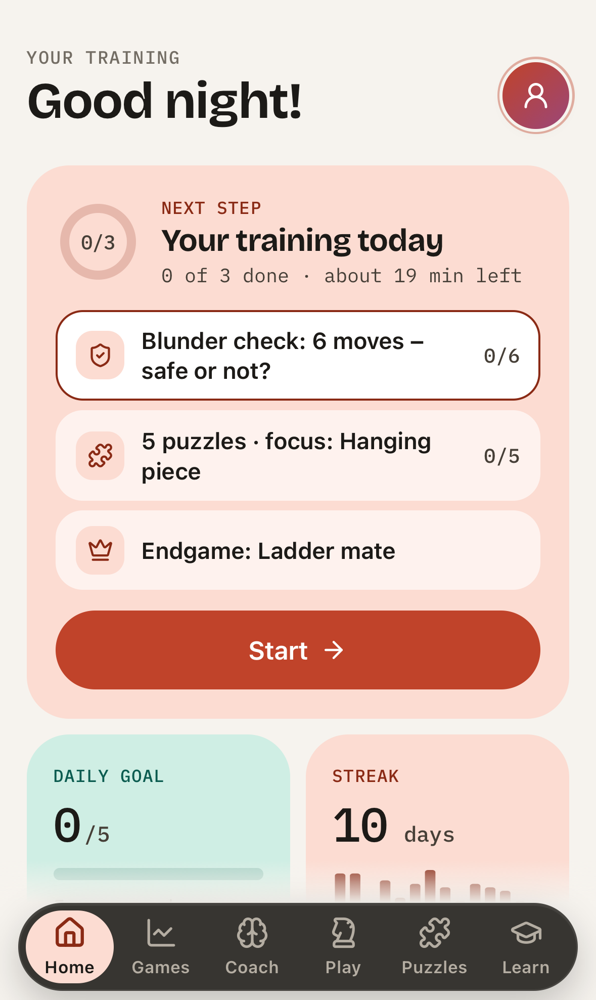 | 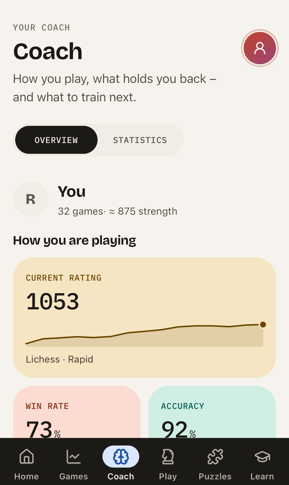 | 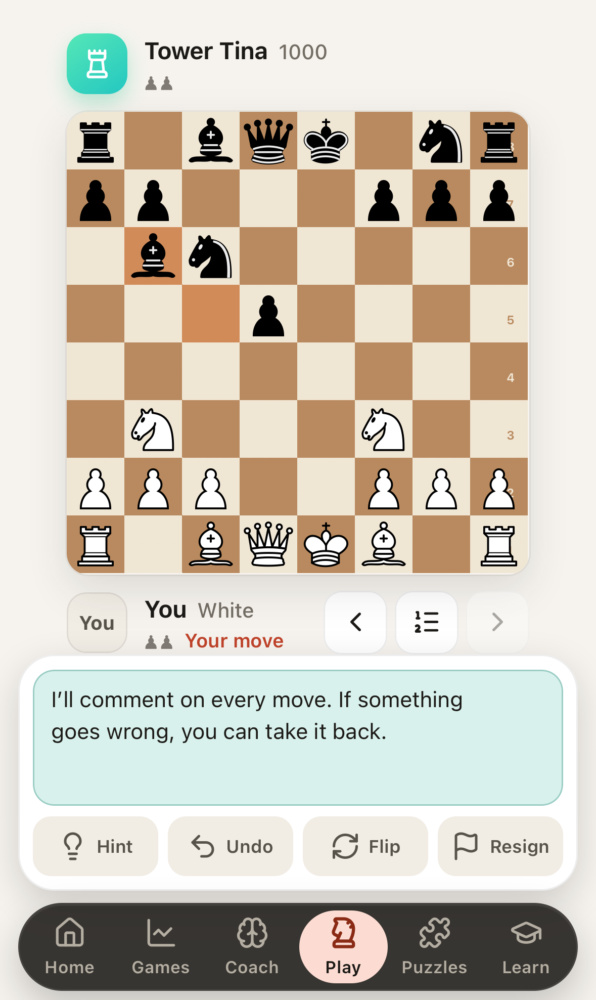 | 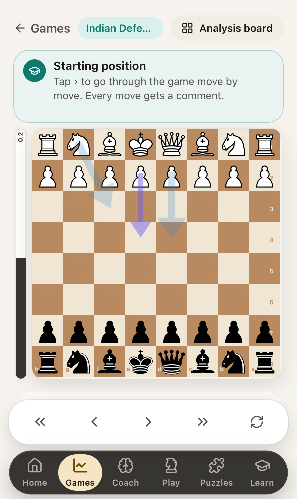 | 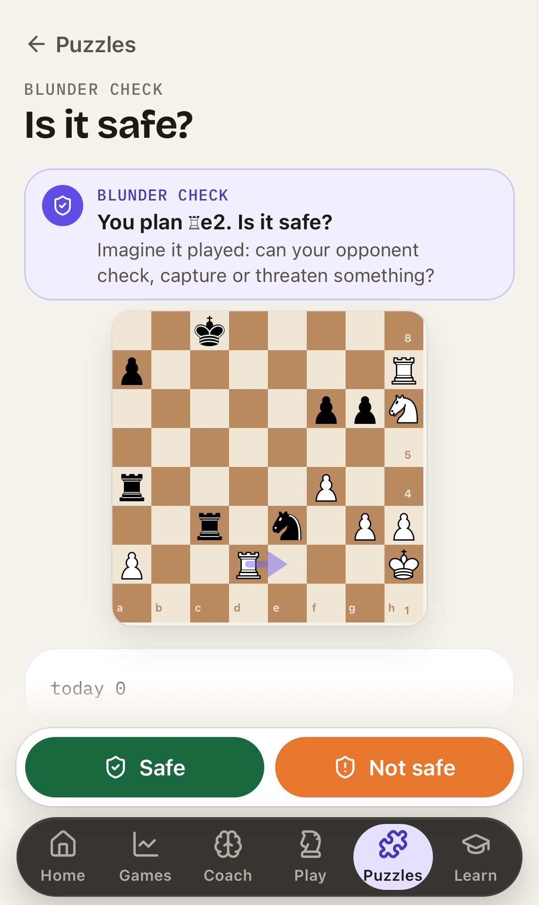 |
| 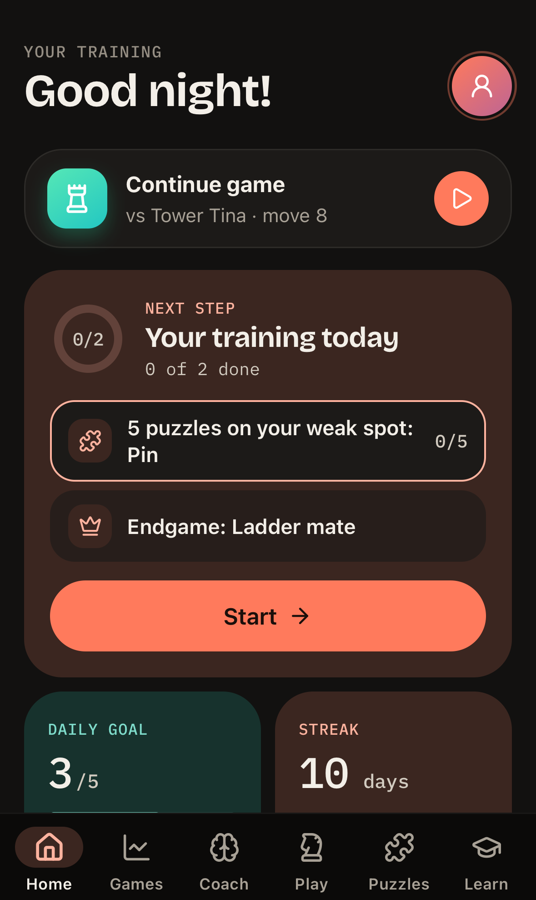                                                 | 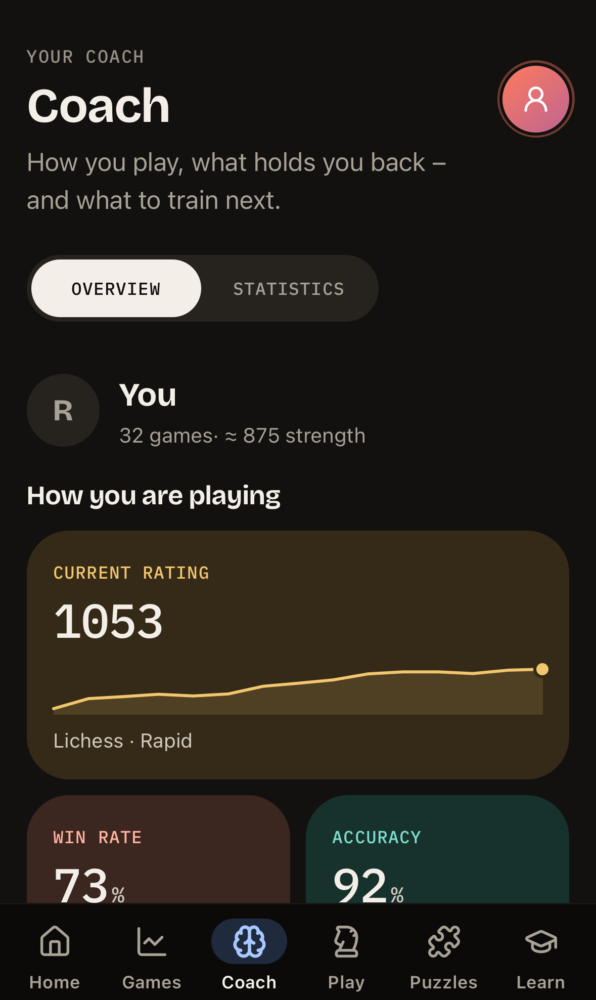                                                              | 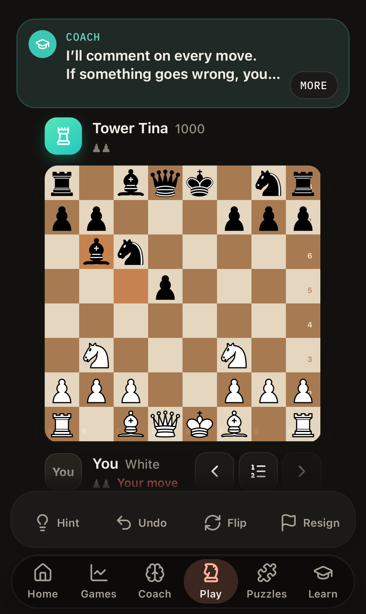                         | 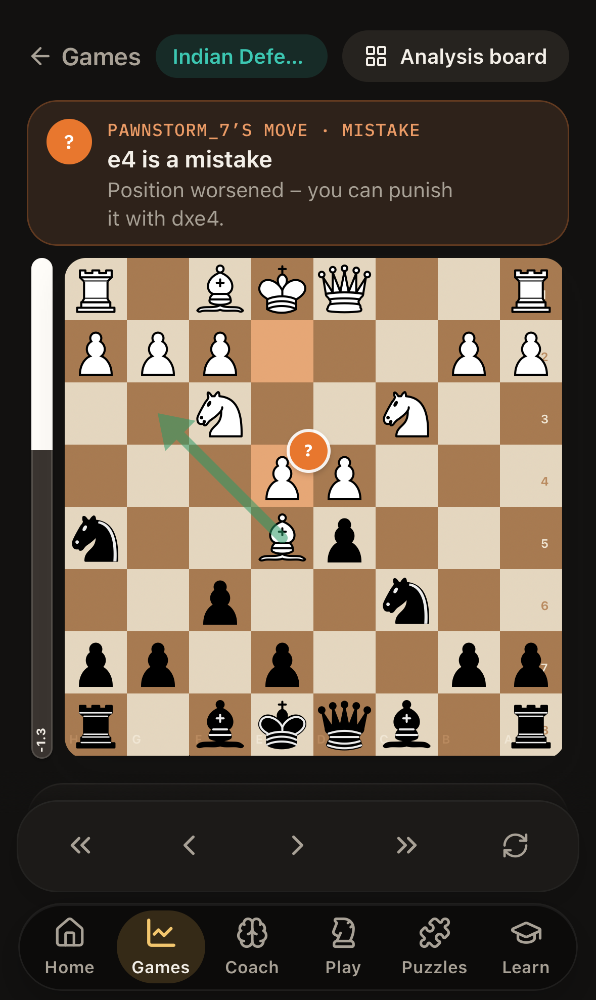                                                  | 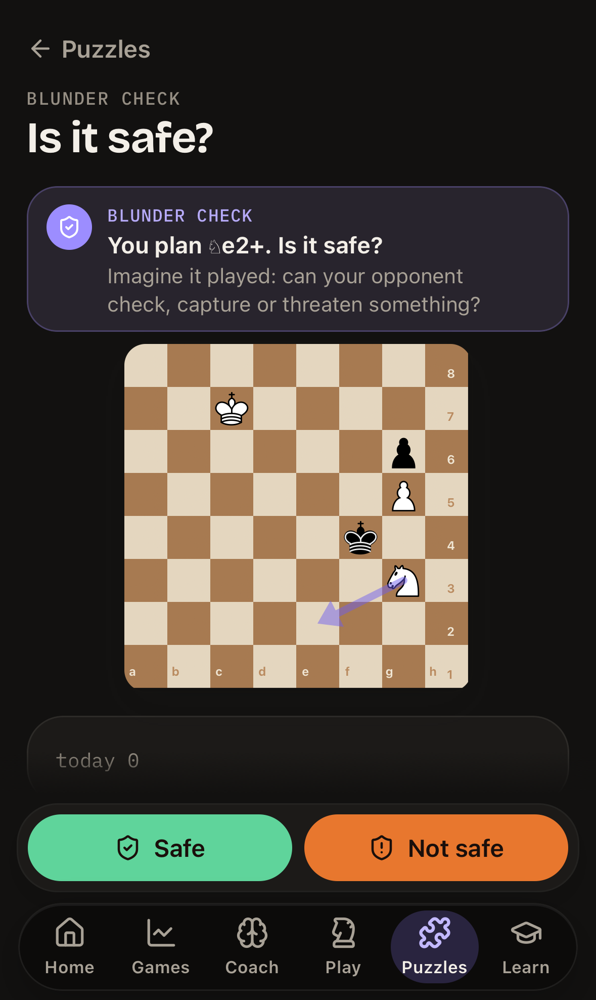                |

**Desktop** (Mac, iPad landscape)

| Light                                                                                                                                                                                     | Dark                                                                                                         |
| ----------------------------------------------------------------------------------------------------------------------------------------------------------------------------------------- | ------------------------------------------------------------------------------------------------------------ |
| 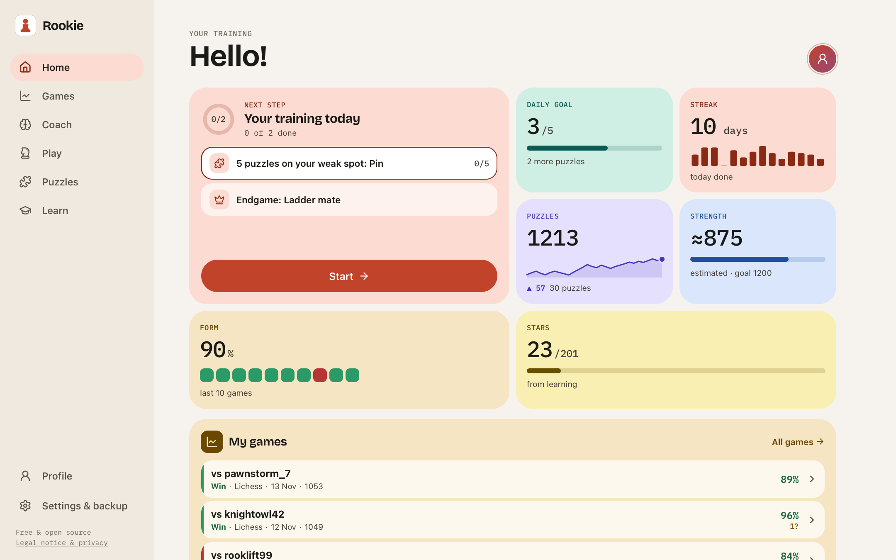     | 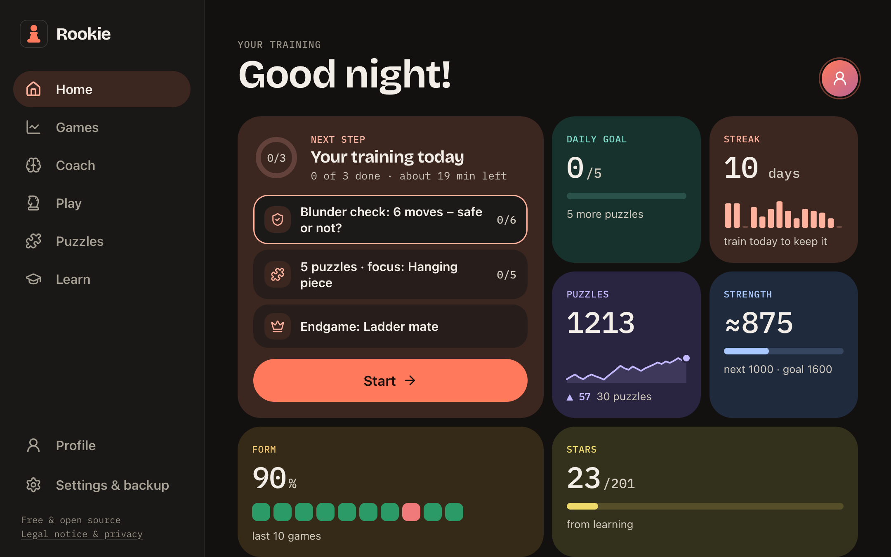            |
| 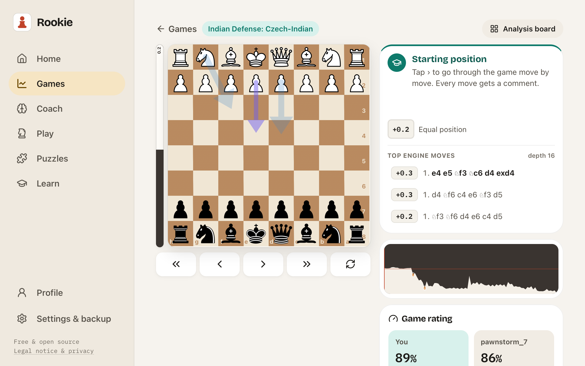 | 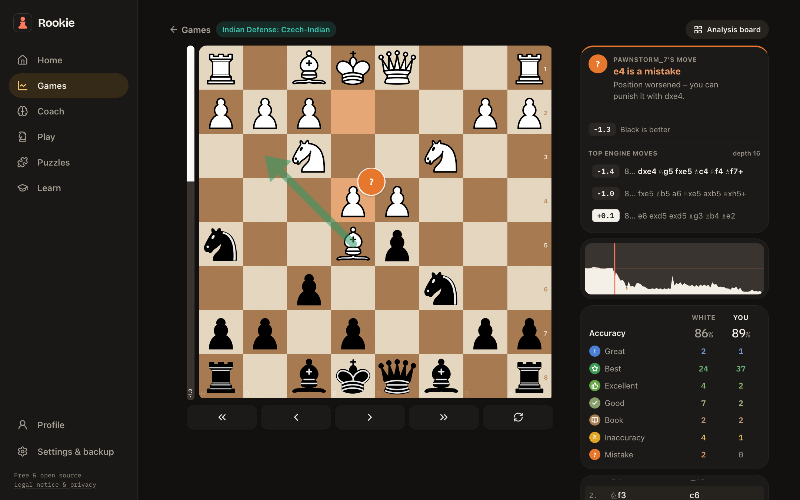 |

Screenshots use generated sample data (`scripts/screenshots/`), not real games.

## Features

Rookie's goal: take beginners to **1600** – with methods that learning research and real game data support ([research](docs/research-2026-11-13.md), [review](docs/learning-review-2026-11-13.md), [plan](docs/learning-plan-2026-11-13.md)).

- **Blunder check** – “You want to play ♘c4. Is it safe?” Real moments from Lichess games (the move a human actually blundered with, or a Stockfish-verified safe move); say “not safe” and you have to show the refutation on the board. Below 1000, over half of all blunders are pieces or mates lost within two moves – this trains exactly that
- **Daily plan with a time budget** (30 min by default) – blunder check, your own mistakes due for review, mixed tactics, a game every other day, then theory only if it fits and matches your level; shows how many minutes are left
- **You first** – after a game from your plan you first mark up to three moves you think were mistakes (no engine ratings shown), then Stockfish reveals what you found, missed or got right, and you replay the mistakes; “mistakes spotted” becomes a progress metric
- **Chance!** – in your first guided games the coach points out when your opponent just blundered (beginners leave about half of them unpunished)
- **Your mistakes come back** – every blunder from your games (bot games are analysed automatically in the background) returns as a task after 1, 3, 8 and 22 days until it sticks
- **Puzzles at the right difficulty** – aimed at ~80 % success instead of 50 %, adjusted to your recent results; a hint counts half; the plan's focus is mixed with other themes
- **Coach that steps back** – warns about threats in your first games, then only asks “what is your opponent up to?” and says “stop – not safe” without giving the answer away (you can still ask). Wins with takebacks or hints don't count towards your strength
- **Is your training working?** – blunders per 30 moves (last 10 games vs the 10 before, with an honest “still within chance”), a safety check-up every two weeks (fixed tasks, two alternating forms) and hit rates in training
- **Game rating** – for each game: accuracy and the level it is typical of, how good the game was for players of your strength (percentile), accuracy per phase, the turning point, chances taken or missed and one lesson to practise. No fake “performance Elo” – measured on 1,440 Lichess games, a single game's accuracy barely predicts rating (R² = 0.14)
- **Fair move ratings** – if two moves were practically equal, yours isn't a mistake; small slips in decided positions don't count; good moves get “just as strong: …” instead of “even stronger was …”
- **Play** against 8 bots with personality (≈ 400–1650) – Stockfish 19 (WebAssembly) in the browser, hints, takebacks, optional clock
- **Game review** – every move classified and explained in plain language, the engine's best moves, evaluation graph, PGN import/export; **replay your mistakes** and find the better move
- **What stands out** – only statements backed by enough games and beyond chance (e.g. an opening at least 8 games and clearly below your average), most important first, each with a matching exercise
- **Progress at a glance** – strength estimate with milestones (800 → 1000 → 1200 → 1400 → 1600), puzzle rating, daily goal, streak
- **Tactics** – fork, pin, skewer, discovered attack, back-rank mate: explained, then practised with puzzles; **Puzzle Storm**; **play a friend** on one device
- **Chess basics** – 15 interactive lessons from zero
- **Puzzles** – 38,400 puzzles from the free Lichess database, Glicko-2 rating, theme filter, puzzle of the day
- **Endgame trainer** – 10 lessons against perfect tablebase play (two thirds of beginner games reach an endgame)
- **Opening courses** – 14 openings and defences; learned lines go into your repertoire for spaced repetition
- **Linked accounts** – link your Lichess / Chess.com username, new games are imported and analysed automatically
- **Optional account** – passkey sign-in, sync across devices; export and delete at any time
- Light/dark mode, English/German, board themes and piece sets, sounds, backup export/import (restoring merges – nothing is lost), works offline, no tracking – all measurements stay on your device

## Development

```bash
npm install          # also copies Stockfish to static/engine
npm run dev          # http://localhost:5173
npm run build && npm run preview
```

Tests:

```bash
npm run test:unit -- --run   # Vitest
npm run test:e2e             # Playwright: iPhone & Mac Safari (WebKit) + Chromium
npm run check && npm run lint
```

Screenshots and design checks:

```bash
node scripts/screenshots/gen-fixture.mjs        # sample games played by Stockfish (committed)
npm run build && npm run preview -- --port 4173 &
node scripts/screenshots/shoot.mjs out/          # all key pages, 4 sizes, light/dark, overflow check
node scripts/contrast.mjs                        # WCAG contrast of the pastel tokens
```

Data scripts (results are committed):

```bash
# Puzzle packs from the Lichess puzzle database (CC0)
curl -L -o .data/lichess_db_puzzle.csv.zst https://database.lichess.org/lichess_db_puzzle.csv.zst
node scripts/build-puzzles.ts

# Opening names from lichess-org/chess-openings (CC0)
node scripts/build-openings.ts

# Blunder-check tasks from the puzzle packs, verified with Stockfish
node scripts/build-safety.mjs

# Research: blunder types and accuracy by rating on real Lichess games (see docs/research-*.md)
node scripts/research/blunder-study.mjs sample.pgn > result.json
node scripts/research/blunder-report.mjs result.json sample.pgn
node scripts/research/performance-study.mjs rapid.pgn > perf.json
node scripts/research/performance-fit.mjs perf.json
```

> Running Node 23 locally? Use `npm install --engine-strict=false`. Node 22 or 24 is recommended (see `.nvmrc`).

### Translations

All UI text lives in `src/lib/i18n/en.ts` (default) and `src/lib/i18n/de.ts`. A unit test makes sure both have exactly the same keys.

## Deployment (Cloudflare Pages, free)

1. Repository on GitHub, connected to a Cloudflare Pages project.
2. Build command `npm run build`, output directory `build`, environment variable `NODE_VERSION = 22`.
3. Custom domains `rookie.maximilianauer.at` (and the former `chess.maximilianauer.at`, which hands data over and redirects) (Pages → Custom domains).
4. Every push to `main` deploys automatically.

[`static/_headers`](static/_headers) sets COOP/COEP so Stockfish can use multiple threads.

### Install on iPhone / iPad

Safari → open https://rookie.maximilianauer.at → **Share** → **Add to Home Screen**.

### Install on Mac

Safari → open the site → **File** → **Add to Dock** (macOS Sonoma or later).

## Licence

GPL-3.0-or-later – see [LICENSE](LICENSE). Third-party projects and their licences are listed in the app under _Profile → About Rookie_.
