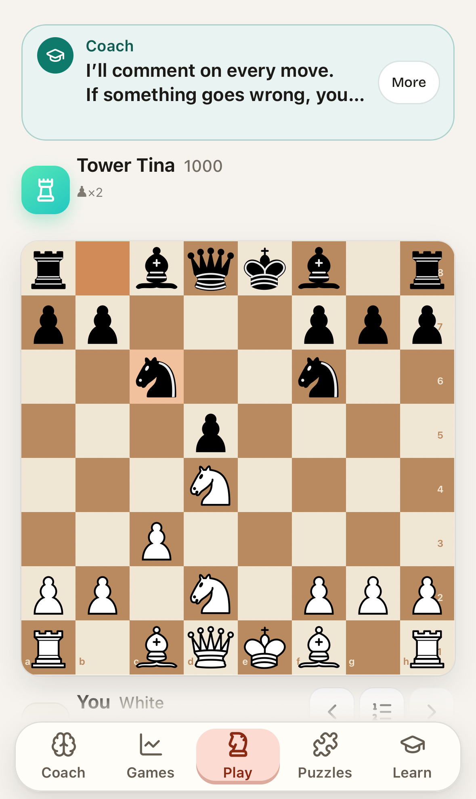
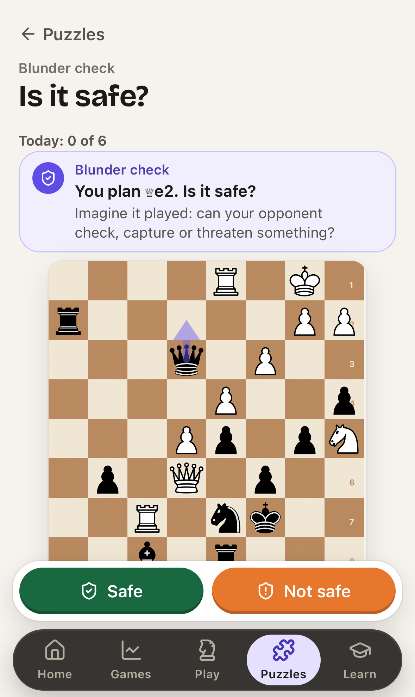
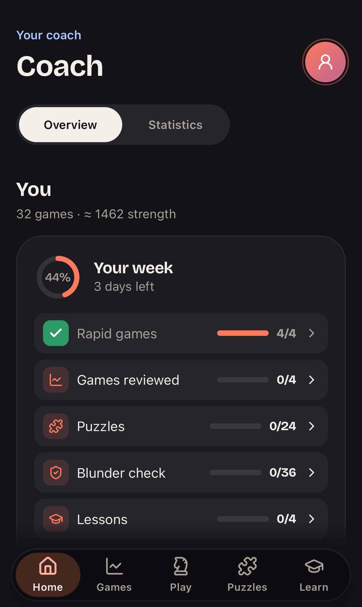
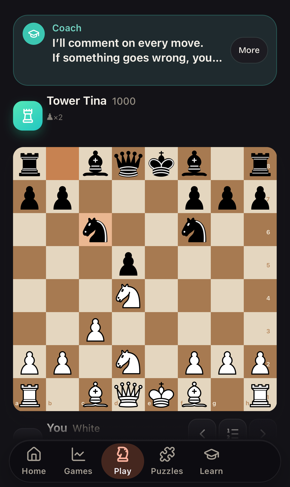
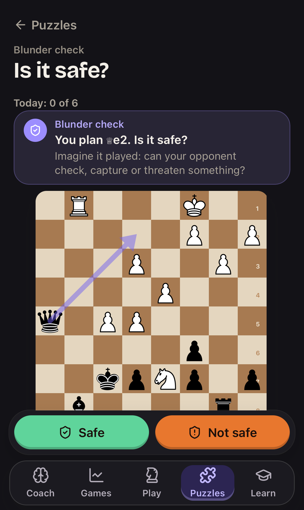
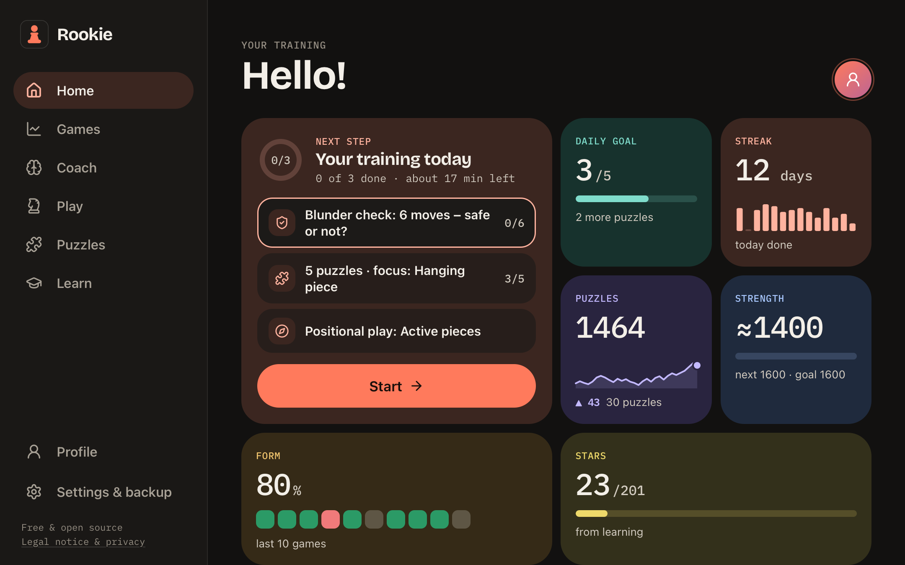
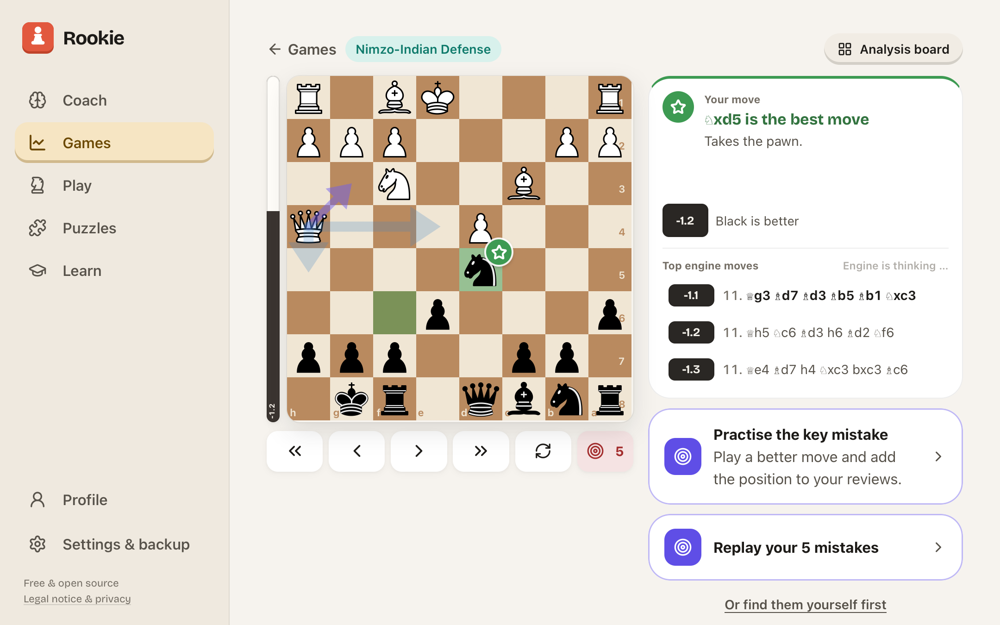
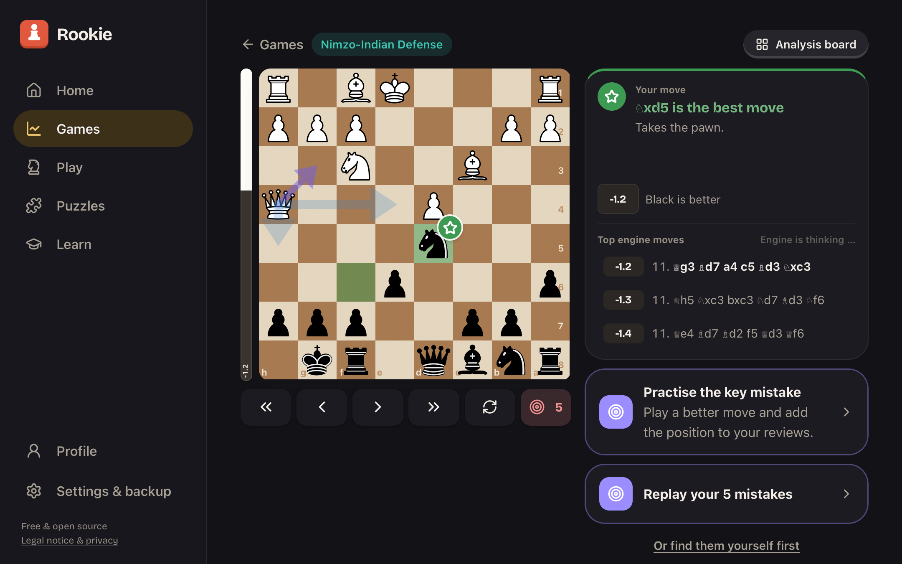

# Rookie – a free chess trainer

A chess trainer for beginners as a Progressive Web App for iPhone, iPad and Mac – completely free, offline-capable, no App Store, no account, no tracking. English and German.

**Live:** https://rookie.maximilianauer.at · **Version:** 0.7.7

| Home                                                                                                                           | Coach                                                                                                                                             | Play                                                                                                   | Game review                                                                                                                                | Blunder check                                                                                            |
| ------------------------------------------------------------------------------------------------------------------------------ | ------------------------------------------------------------------------------------------------------------------------------------------------- | ------------------------------------------------------------------------------------------------------ | ------------------------------------------------------------------------------------------------------------------------------------------ | -------------------------------------------------------------------------------------------------------- |
|  |  |  |  |  |
|                                                  |                                                               |                          |                                                   |                 |

**Desktop** (Mac, iPad landscape)

| Light                                                                                                                                                                                     | Dark                                                                                                         |
| ----------------------------------------------------------------------------------------------------------------------------------------------------------------------------------------- | ------------------------------------------------------------------------------------------------------------ |
|      |             |
|  |  |

Screenshots use generated sample data (`scripts/screenshots/`), not real games.

## What's new in 0.7.7

- Bot games use the available board width on phones in portrait. The game controls sit below the player row so every square stays tappable on short screens.
- Coach feedback and highlights update without reapplying an identical chess position.

## What's new in 0.7.6

- The daily plan starts with missing rules, then guides you to rated Rapid and a short review of your game. The 5-minute setting keeps the next Rapid session visible.
- The road to 1600 shows your latest imported rated Lichess Rapid rating. Game trends use that same pool. Puzzle scores and bot results stay separate.
- Practise one important mistake from a game and save its result for spaced review.

## What's new in 0.7.5

- Blunder Check, including the check-up, explains each answer immediately. The score trend compares check-ups with the same feedback format.
- Board Scan counts real captures and shows a checking castle with the king's destination. Training shows progress against today's plan.
- The game self-review shows the current move and your marks, then offers to replay the mistakes or return to the original game.
- Mobile bot games keep the board steady during play. Promotion shows four larger piece graphics and a Cancel button.

## Features

Rookie's goal: take beginners to **1600** – with methods that learning research and real game data support ([research](docs/research-2026-11-13.md), [review](docs/learning-review-2026-11-13.md), [plan](docs/learning-plan-2026-11-13.md), [product review](docs/product-review-2026-11-14.md)).

- **Skill penta** – your game as five skills (safety, tactics, opening, positional play, endgame), each as an Elo equivalent calibrated on 1,560 Lichess games from 400 to 3200; 100 = world elite. **Checked on 139 real players outside the calibration:** overall level within ±230 Elo from about 12 games (guessing: ±500); a corner only appears once it beats guessing. Tap a corner: one number, values at other levels and one next step – if your opening or endgame losses are mostly blunders, it sends you to the blunder check instead of more theory
- **What counts at your level** – four stages on the way to 1600 and beyond; the weight of each skill comes from real games (below 1200, safety and tactics explain most of the gap to the next level)
- **Board scan** – see checks, captures and hanging pieces in seconds, for you and your opponent (CCA), on real positions; daily in the plan below 1200
- **Positional play** – five lessons with Stockfish-checked tasks: active pieces and outposts, open files, passed pawns, king safety, pawn structure
- **Blunder check** – “You want to play ♘c4. Is it safe?” Real moments from Lichess games (the move a human actually blundered with, or a Stockfish-verified safe move); say “not safe” and you have to show the refutation on the board. Below 1000, over half of all blunders are pieces or mates lost within two moves – this trains exactly that
- **Daily plan with a time budget** (30 min by default) – blunder check, your own mistakes due for review, mixed tactics, a rated Rapid game when there is a suitable time block, then theory only if it fits and matches your level; shows how many minutes are left
- **You first** – in the game review you can first mark up to three moves you think were mistakes (no engine ratings shown), then Stockfish reveals what you found, missed or got right, and you replay the mistakes; “mistakes spotted” becomes a progress metric
- **Chance!** – in your first guided games the coach points out when your opponent just blundered (beginners leave about half of them unpunished)
- **Your mistakes come back** – every blunder from your games (bot games are analysed automatically in the background) returns as a task after 1, 3, 8 and 22 days until it sticks
- **Puzzles at the right difficulty** – aimed at ~80 % success instead of 50 %, adjusted to your recent results; a hint counts half; the plan's focus is mixed with other themes
- **Coach that steps back** – warns about threats in your first games, then asks “what is your opponent up to?” (you can still ask for help). The coach comments as the game continues, and you can take back a move during play. Wins with takebacks or hints don't count towards your strength
- **Is your training working?** – blunders per 30 moves (last 10 games vs the 10 before, with an honest “still within chance”), a safety check-up every two weeks (fixed tasks, two alternating forms) and hit rates in training
- **Game rating** – for each game: accuracy and the level it is typical of, how good the game was for players of your strength (percentile), accuracy per phase, the turning point, chances taken or missed and one lesson to practise. No fake “performance Elo” – measured on 1,440 Lichess games, a single game's accuracy barely predicts rating (R² = 0.14)
- **Fair move ratings** – if two moves were practically equal, yours isn't a mistake; small slips in decided positions don't count; good moves get “just as strong: …” instead of “even stronger was …”
- **Play** against 8 bots with personality (≈ 400–1650) – Stockfish 19 (WebAssembly) in the browser, hints, takebacks, optional clock, and one premove while the bot is thinking. Premoves play automatically if legal after the reply. Tap the premove label, right-click the board, or press Esc to clear it
- **Game review** – every move classified and explained in plain language, the engine's best moves, evaluation graph, PGN import/export; try your own lines directly on the review board and return to the original game; **replay your mistakes** and find the better move
- **What stands out** – only statements backed by enough games and beyond chance (e.g. an opening at least 8 games and clearly below your average), most important first, each with a matching exercise
- **Road to 1600** – the latest imported rated Lichess Rapid result anchors the plan when available. Local practice estimates guide the exercises while you build a real-game history
- **One blunder number** – “blunders per 30 moves” means the same everywhere (moves in still-open positions), plus **converted**: how many clearly won positions you actually won (Lichess players up to 1400: ≈ 69 %)
- **Tactics** – fork, pin, skewer, discovered attack, back-rank mate: explained, then practised with puzzles; **Puzzle Storm**; **play a friend** on one device
- **Chess basics** – 15 interactive lessons from zero
- **Puzzles** – 38,400 puzzles from the free Lichess database, Glicko-2 rating, theme filter, puzzle of the day
- **Endgame trainer** – 10 lessons against perfect tablebase play (two thirds of beginner games reach an endgame)
- **Opening courses** – 14 openings and defences; learned lines go into your repertoire for spaced repetition
- **Linked accounts** – link your Lichess / Chess.com username, new games are imported and analysed automatically
- **Optional account** – passkey sign-in, sync across devices; export and delete at any time
- Light/dark mode, English/German, board themes and piece sets, sounds, backup export/import (restoring merges – nothing is lost), works offline, no tracking – all measurements stay on your device

## Development

```bash
npm install          # also copies Stockfish to static/engine
npm run dev          # http://localhost:5173
npm run build && npm run preview
```

Tests:

```bash
npm run test:unit -- --run   # Vitest
npm run test:e2e             # Playwright: iPhone & Mac Safari (WebKit) + Chromium
npm run check && npm run lint
```

Screenshots and design checks:

```bash
node scripts/screenshots/gen-fixture.mjs        # sample games played by Stockfish (committed)
npm run build && npm run preview -- --port 4173 &
node scripts/screenshots/shoot.mjs out/          # all key pages, 4 sizes, light/dark, overflow check
node scripts/contrast.mjs                        # WCAG contrast of the pastel tokens
```

Data scripts (results are committed):

```bash
# Puzzle packs from the Lichess puzzle database (CC0)
curl -L -o .data/lichess_db_puzzle.csv.zst https://database.lichess.org/lichess_db_puzzle.csv.zst
node scripts/build-puzzles.ts

# Opening names from lichess-org/chess-openings (CC0)
node scripts/build-openings.ts

# Blunder-check tasks from the puzzle packs, verified with Stockfish
node scripts/build-safety.mjs

# Research: blunder types and accuracy by rating on real Lichess games (see docs/research-*.md)
node scripts/research/blunder-study.mjs sample.pgn > result.json
node scripts/research/blunder-report.mjs result.json sample.pgn
node scripts/research/performance-study.mjs rapid.pgn > perf.json
node scripts/research/performance-fit.mjs perf.json
```

> Running Node 23 locally? Use `npm install --engine-strict=false`. Node 22 or 24 is recommended (see `.nvmrc`).

### Translations

All UI text lives in `src/lib/i18n/en.ts` (default) and `src/lib/i18n/de.ts`. A unit test makes sure both have exactly the same keys.

## Deployment (Cloudflare Pages, free)

1. Repository on GitHub, connected to a Cloudflare Pages project.
2. Build command `npm run build`, output directory `build`, environment variable `NODE_VERSION = 22`.
3. Custom domains `rookie.maximilianauer.at` (and the former `chess.maximilianauer.at`, which hands data over and redirects) (Pages → Custom domains).
4. Every push to `main` deploys automatically.

[`static/_headers`](static/_headers) sets COOP/COEP so Stockfish can use multiple threads.

### Install on iPhone / iPad

Safari → open https://rookie.maximilianauer.at → **Share** → **Add to Home Screen**.

### Install on Mac

Safari → open the site → **File** → **Add to Dock** (macOS Sonoma or later).

## Licence

GPL-3.0-or-later – see [LICENSE](LICENSE). Third-party projects and their licences are listed in the app under _Profile → About Rookie_.
